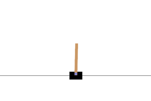

# Aprendizaje por refuerzo con Gymnasium

Mis notebooks del curso de freeCodeCamp: [Python Reinforcement Learning using Gymnasium](https://www.youtube.com/watch?v=vufTSJbzKGU).

- `00_fundamentos` – cómo funciona un agente dentro de un juego.
- `01_blackjack_qlearning` – un agente aprende a jugar Blackjack con una tabla (Q-learning).
- `02_cartpole_dqn` – un agente aprende a equilibrar un palo con una red neuronal (DQN).
- `03_pettingzoo_multiagente` – juegos con varios agentes (gato y piedra, papel o tijera).



## Cómo correrlo

```
pip install -r requirements.txt
jupyter notebook
```
